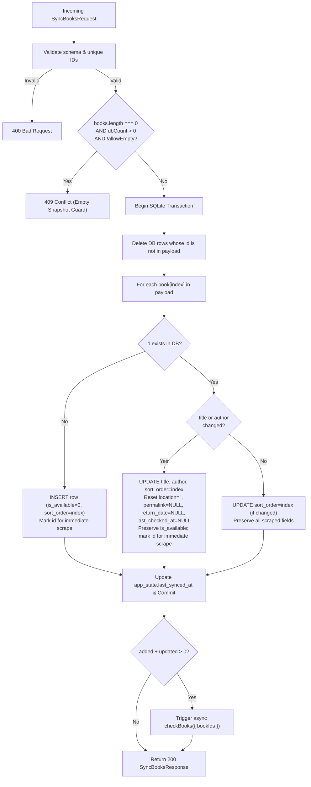

# 01 — Data Model, SQLite Schema & Sync API Specification

This document specifies the data structures, SQLite schema, reconciliation semantics, and HTTP API contract for `bibo-tracker`. Both the `bibo-tracker` server refactoring ([02-data-layer-refactoring-plan.md](./02-data-layer-refactoring-plan.md)) and the external Anytype connector ([03-anytype-connector-guide.md](./03-anytype-connector-guide.md)) implement against this contract.

---

## 1. Domain Models

### 1.1 Internal `Book` Model (`src/types/models/book.ts`)

Replaces `notionId` with a source-agnostic `id` (populated with the Anytype object ID) and persists `returnDate` (which was previously sent to Notion's `Rückgabedatum` property and discarded locally) plus `lastCheckedAt`.

```ts
export type Book = {
	/** Stable external identifier from the upstream note app (e.g. Anytype object ID). */
	id: string;
	/** Book title used for display and library catalog search. */
	title: string;
	/** Author name(s) used for display and library catalog search (may be empty string ""). */
	author: string;
	/** Whether at least one copy is currently available in Zentralbibliothek. */
	isAvailable: boolean;
	/** Shelf location string combining Systematik and Interessenkreis (e.g. "R 11 Thriller"). */
	location: string;
	/** Direct permalink to the catalog detail page, if found. */
	permalink: string | null;
	/** Earliest expected return date in ISO format (YYYY-MM-DD) when borrowed, or null when available/unknown. */
	returnDate: string | null;
	/** ISO-8601 UTC timestamp of the last successful catalog check for this book, or null if never checked. */
	lastCheckedAt: string | null;
};
```

### 1.2 Application State Model (`src/types/models/state.ts`)

```ts
export type State = {
	/** Timestamp of the last completed full/scheduled catalog check. */
	lastChecked: Date | null;
	/** Timestamp of the last successful POST /api/books sync from the connector. */
	lastSynced: Date | null;
};
```

### 1.3 Connector Sync Payload Models (`src/types/api/sync-books.ts`)

The connector sends only the fields owned by Anytype. Catalog-derived fields (`isAvailable`, `location`, `permalink`, `returnDate`) are managed exclusively by `bibo-tracker`.

```ts
/** Single book entry sent by the Anytype connector. */
export type SyncBookInput = {
	/** Unique, stable Anytype object ID (e.g. "bafyreig..."). Required, non-empty. */
	id: string;
	/** Book title. Required, non-empty after trimming. */
	title: string;
	/** Book author(s). Optional; defaults to "" if omitted or null. */
	author?: string | null;
};

/** Request body for POST /api/books */
export type SyncBooksRequest = {
	/** Complete ordered list of books currently tracked in Anytype. */
	books: SyncBookInput[];
	/**
	 * Safety flag required to intentionally wipe all books when `books` is `[]`
	 * and the database currently contains >= 1 book. Defaults to false.
	 */
	allowEmpty?: boolean;
};

/** Response body for POST /api/books */
export type SyncBooksResponse = {
	syncedAt: string; // ISO-8601 UTC timestamp
	total: number; // Total books stored after sync
	added: number; // Newly inserted books
	updated: number; // Existing books whose title or author changed
	unchanged: number; // Existing books with identical title and author
	removed: number; // Previously stored books deleted because they were absent from payload
	scrapeTriggered: boolean; // True if background checkBooks was triggered for added/updated books
};
```

---

## 2. SQLite Schema (`bun:sqlite`)

### 2.1 File Location & Connection Pragmas

- **Database file path:** `Bun.env.DATABASE_PATH || './data/bibo.sqlite'`
  - Supports `:memory:` for fast, isolated unit/integration tests.
  - Parent directory (`./data`) is created automatically at startup via `mkdirSync(dirname(dbPath), { recursive: true })` whenever `dbPath !== ':memory:'`.
- **Required connection options & pragmas:**
  ```ts
  const db = new Database(dbPath, { create: true, strict: true });
  db.exec('PRAGMA journal_mode = WAL;');
  db.exec('PRAGMA busy_timeout = 5000;');
  db.exec('PRAGMA foreign_keys = ON;');
  ```
  - `strict: true` allows binding named parameters (`{ id: '...' }`) without `$` prefixes on object keys.
  - `WAL` mode + `busy_timeout = 5000` allows concurrent reads from `GET /`, writes from `POST /api/books`, and CLI runs (`bun run check-books`) without `SQLITE_BUSY` errors.

### 2.2 Tables DDL

```sql
CREATE TABLE IF NOT EXISTS books (
	id              TEXT PRIMARY KEY,
	title           TEXT NOT NULL,
	author          TEXT NOT NULL DEFAULT '',
	sort_order      INTEGER NOT NULL DEFAULT 0,
	is_available    INTEGER NOT NULL DEFAULT 0 CHECK (is_available IN (0, 1)),
	location        TEXT NOT NULL DEFAULT '',
	permalink       TEXT,
	return_date     TEXT,
	last_checked_at TEXT,
	created_at      TEXT NOT NULL,
	updated_at      TEXT NOT NULL
);

CREATE INDEX IF NOT EXISTS idx_books_sort_order ON books(sort_order ASC);

CREATE TABLE IF NOT EXISTS app_state (
	key   TEXT PRIMARY KEY,
	value TEXT NOT NULL
);
```

#### Stored Keys in `app_state`
| `key` | `value` format | Meaning |
| :--- | :--- | :--- |
| `last_checked_at` | ISO-8601 UTC string (`2026-10-26T15:00:00.000Z`) | Last completed `checkBooks()` run |
| `last_synced_at` | ISO-8601 UTC string (`2026-10-26T15:05:12.000Z`) | Last accepted `POST /api/books` sync |

---

## 3. Data Reconciliation Rules

### 3.1 Full Snapshot Sync (`POST /api/books`)

All changes execute atomically inside a single `db.transaction(...)`:



#### Important Behavioral Details
1. **Incoming Order Preservation:** Each item's array index (`0, 1, 2, ...`) is stored in `sort_order`. Queries read `ORDER BY sort_order ASC`. The web UI (`BookList`) continues to sort available books to the top while preserving Anytype's incoming order within the available and borrowed groups.
2. **Edited Title or Author:** If a user fixes a typo in `title` or `author` in Anytype (same `id`), catalog-specific metadata (`location`, `permalink`, `return_date`, `last_checked_at`) is cleared so stale metadata from the old search query does not linger, and the book is queued for immediate background re-scraping. `is_available` is intentionally preserved until the re-scrape completes so minor edits to an already-available book do not trigger duplicate `ntfy` push notifications.
3. **Empty Snapshot Safeguard:** If the Anytype daemon on the Raspberry Pi is still starting up or a view filter breaks and returns `0` items while `bibo-tracker` currently stores books, rejecting `{ "books": [] }` with `409 Conflict` (unless `"allowEmpty": true` is explicitly passed) prevents accidental loss of all stored books and their availability history.

### 3.2 Scraper Status Update (`updateBookScraperStatus`)

When `checkBooks` finishes scraping a book (`ScraperResult`), its row is updated as follows:

- `is_available`: `result.isAvailable ? 1 : 0`
- `return_date`:
  - If `result.isAvailable === true`: set to `NULL` (at least one copy is on the shelf, so any prior return date is obsolete).
  - Else if `result.returnDate?.isValid`: set to `result.returnDate.toISODate()` (`YYYY-MM-DD`).
  - Else: set to `NULL`.
- `location`: If `result.location` is non-empty after trimming, overwrite `location`; otherwise keep existing `location` (`COALESCE(NULLIF(?, ''), location)`).
- `permalink`: If `result.permalink` is non-empty after trimming, overwrite `permalink`; otherwise keep existing `permalink` (`COALESCE(NULLIF(?, ''), permalink)`).
- `last_checked_at` & `updated_at`: current ISO-8601 UTC timestamp (`new Date().toISOString()`).

---

## 4. HTTP API Specification

### 4.1 Authentication

- **Protected routes:** `POST /api/books` and `GET /api/books`.
- **Public routes:** `GET /`, `POST /refresh`, and `GET /api/health`.
- **Mechanism:** Standard HTTP Bearer authentication header:
  ```http
  Authorization: Bearer <API_KEY>
  ```
- **Server configuration:** Configured via `API_KEY` environment variable (recommended minimum 32 random hex/base64 characters, e.g. generated with `openssl rand -hex 32`).
- **Comparison security:** Compare SHA-256 digests of the expected and provided tokens using `node:crypto`'s `timingSafeEqual` so neither timing differences nor token length are leaked.
- **Unconfigured `API_KEY` behavior:** If `API_KEY` is unset or empty, the server still boots (allowing UI rendering and CI smoke tests) and logs a startup warning, while all requests to `/api/books` fail closed with `503 Service Unavailable`.

### 4.2 Endpoints Overview

| Method | Path | Auth | Purpose |
| :--- | :--- | :--- | :--- |
| `GET` | `/` | Public | Renders the SSR React `bibowatch` web page. |
| `POST` | `/refresh` | Public | Triggers an asynchronous full `checkBooks()` run (no-op `200` if a check is already running). |
| `GET` | `/api/health` | Public | Returns JSON health & timestamp summary for monitoring and Docker/CI checks. |
| `POST` | `/api/books` | Bearer `API_KEY` | Replaces tracked book list via full snapshot sync. |
| `GET` | `/api/books` | Bearer `API_KEY` | Returns currently stored `Book[]` and state metadata as JSON. |

---

### 4.3 `POST /api/books` — Sync Book Snapshot

#### Request Headers
```http
POST /api/books HTTP/1.1
Host: bibo.example.com
Authorization: Bearer <API_KEY>
Content-Type: application/json
```

#### Request Body Example
```json
{
  "books": [
    {
      "id": "bafyreigyb6l5szohs32ts26ku2j42yd65e6hqy2u3gtzgdwqv6hzftsetu",
      "title": "Holly",
      "author": "Stephen King"
    },
    {
      "id": "bafyreih7x4m2p9k8q3w5v1n6z0c4b2j8r5t7y9u1i3o5p7a9s1d3f5g7h9",
      "title": "Die Mitternachtsbibliothek",
      "author": "Matt Haig"
    }
  ],
  "allowEmpty": false
}
```

#### Input Validation Rules
1. Body must be valid JSON object (`Content-Type: application/json`, max body size 1 MB).
2. `books` must be an `Array` (max 1,000 items).
3. For every element `books[i]`:
   - Must be a non-null plain object.
   - `id`: `string`, trimmed length `1..256`. Must be unique across the `books` array (duplicate `id`s in the same request return `400`).
   - `title`: `string`, trimmed length `1..500`.
   - `author`: `undefined | null | string`; if string, trimmed length `0..500` (normalized to `""` if omitted/null).
4. `allowEmpty`: optional `boolean` (defaults to `false`).

#### Success Response (`200 OK`)
```json
{
  "syncedAt": "2026-10-26T16:30:00.000Z",
  "total": 2,
  "added": 1,
  "updated": 0,
  "unchanged": 1,
  "removed": 0,
  "scrapeTriggered": true
}
```

#### Error Responses
| Status | Condition | Example Body |
| :--- | :--- | :--- |
| `400 Bad Request` | Malformed JSON, missing `books` array, empty `id`/`title`, or duplicate `id` | `{ "error": "Validation failed", "details": ["books[1].title must be a non-empty string"] }` |
| `401 Unauthorized` | Missing, malformed, or invalid `Authorization: Bearer ...` header | `{ "error": "Unauthorized" }` |
| `409 Conflict` | `books` is `[]`, DB currently has `> 0` books, and `allowEmpty` is not `true` | `{ "error": "Refusing to clear 12 existing books without allowEmpty=true" }` |
| `413 Payload Too Large` | Request body exceeds 1 MB | `{ "error": "Payload too large" }` |
| `503 Service Unavailable` | `API_KEY` env var is not configured on server | `{ "error": "Sync API is not configured" }` |

---

### 4.4 `GET /api/books` — Inspect Stored Books

Useful for verifying connector pushes and debugging without inspecting the SQLite file directly.

#### Response (`200 OK`)
```json
{
  "books": [
    {
      "id": "bafyreigyb6l5szohs32ts26ku2j42yd65e6hqy2u3gtzgdwqv6hzftsetu",
      "title": "Holly",
      "author": "Stephen King",
      "isAvailable": true,
      "location": "R 11 Thriller",
      "permalink": "https://katalog.halle.de/...",
      "returnDate": null,
      "lastCheckedAt": "2026-10-26T16:30:18.412Z"
    }
  ],
  "lastChecked": "2026-10-26T16:00:42.100Z",
  "lastSynced": "2026-10-26T16:30:00.000Z"
}
```

---

### 4.5 `GET /api/health` — Public Health Check

#### Response (`200 OK`)
```json
{
  "status": "ok",
  "bookCount": 2,
  "isChecking": false,
  "lastChecked": "2026-10-26T16:00:42.100Z",
  "lastSynced": "2026-10-26T16:30:00.000Z"
}
```
