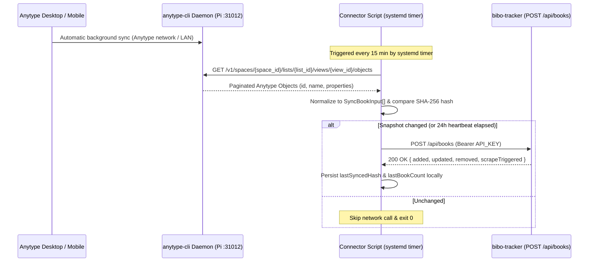

# 03 — Anytype Connector Implementation Guide

This guide specifies how to set up a headless Anytype node on a home-network device (e.g., Raspberry Pi) and implement a lightweight standalone TypeScript/Bun connector that reads tracked library books from Anytype's Local API and pushes snapshots to `bibo-tracker`'s `POST /api/books` endpoint.

---

## 1. Connector Architecture & Data Flow

Because Anytype is local-first with end-to-end encrypted peer-to-peer / relay synchronization, Anytype provides **`anytype-cli`** (which embeds `anytype-heart` without an Electron GUI) specifically for headless servers and Raspberry Pis.



### Why Use a Dedicated Anytype Bot Account on the Pi?
Instead of putting your primary master recovery phrase onto the Raspberry Pi:
1. Create a dedicated local **bot account** on the Pi via `anytype-cli`.
2. Invite that bot account with **Reader** permissions to *only* the Space containing your reading list.
3. Because synchronization to `bibo-tracker` is strictly one-way, the Pi never needs write permissions or access to unrelated personal notes.

---

## 2. Headless Anytype Setup on Raspberry Pi (`anytype-cli`)

### 2.1 Install `anytype-cli` (ARM64 / Raspberry Pi OS 64-bit)

```bash
# Install the official anytype-cli binary
/usr/bin/env bash -c "$(curl -fsSL https://raw.githubusercontent.com/anyproto/anytype-cli/main/install.sh)"

# Install and start as a background systemd user service
anytype service install
anytype service start

# Ensure user services stay running after logout / reboot on Raspberry Pi OS
sudo loginctl enable-linger "$USER"
```

### 2.2 Create Bot Account, Join Space & Generate Local API Key

1. **Create the bot identity on the Pi:**
   ```bash
   anytype auth create "bibo-pi-connector"
   ```
2. **Share your Books Space from Anytype Desktop/Mobile:**
   - Open your Space settings in Anytype → **Members** → **Invite Link** → select **Reader** permission.
   - Join from the Pi:
     ```bash
     anytype space join "<your-anytype-invite-link>"
     anytype space list
     ```
3. **Create a Local HTTP API key:**
   ```bash
   anytype auth apikey create "bibo-connector-key"
   ```
   Save the printed Bearer token for the connector's `ANYTYPE_API_KEY` environment variable.

### 2.3 Port Reference (`31012` vs. `31009`)

| Environment | Default Local API Base URL | Notes |
| :--- | :--- | :--- |
| **Raspberry Pi (`anytype-cli`)** | `http://127.0.0.1:31012` | Headless daemon binds to `31012` so it never conflicts with Desktop ports. |
| **Local Dev (Anytype Desktop)** | `http://127.0.0.1:31009` | Useful when developing/testing the connector on your Mac before deploying to the Pi. |

All requests to the Anytype Local API require two headers:
```http
Authorization: Bearer <ANYTYPE_API_KEY>
Anytype-Version: 2025-11-08
```

---

## 3. Querying Books from Anytype

In Notion, `bibo-tracker` previously filtered a database by:
- `Ansicht == "Nächste"` AND `Medium == "Bibliothek"`
- Mapping `Titel` → `title` and `Autor` → `author`.

In Anytype, there are two ways to retrieve this filtered list. **Approach A (Saved Set/Collection View) is strongly recommended.**

### Approach A (Recommended): Query a Dedicated Anytype Set / Collection View

Create a **Set** (or **Collection**) in Anytype for your Books and configure a dedicated **View** (e.g., named `"Bibo Tracker"` or `"Nächste (Bibliothek)"`) filtered inside the Anytype UI (`Ansicht = Nächste` and `Medium = Bibliothek`).

- **Endpoint:**
  ```http
  GET /v1/spaces/{space_id}/lists/{list_id}/views/{view_id}/objects?limit=100&offset=0
  ```
- **Advantages:**
  1. **Zero hardcoded filter tag IDs:** You can adjust filter rules (e.g. adding a tag or pausing a book) visually in Anytype on Desktop/Mobile without touching connector code on the Raspberry Pi.
  2. **Automatic sort order:** Objects are returned in the exact order configured in that Anytype View, which `bibo-tracker` preserves via `sort_order`.

### Approach B (Alternative): Space Search with Property Filters

If you prefer querying across the entire Space without relying on a specific Set View:

- **Endpoint:**
  ```http
  POST /v1/spaces/{space_id}/search?limit=100&offset=0
  ```
- **Body:**
  ```json
  {
    "types": ["book"],
    "filters": {
      "operator": "and",
      "conditions": [
        {
          "property_key": "ansicht",
          "condition": "eq",
          "select": "<naechste_tag_id>"
        },
        {
          "property_key": "medium",
          "condition": "eq",
          "select": "<bibliothek_tag_id>"
        }
      ]
    },
    "sort": {
      "property_key": "last_modified_date",
      "direction": "desc"
    }
  }
  ```

### Mapping Anytype Object Fields to `SyncBookInput`

Each object returned by Anytype's `/v1/` endpoints has the following relevant shape:

```json
{
  "id": "bafyreigyb6l5szohs32ts26ku2j42yd65e6hqy2u3gtzgdwqv6hzftsetu",
  "name": "Holly",
  "properties": [
    {
      "id": "bafyrei...",
      "key": "author",
      "name": "Autor",
      "format": "text",
      "text": "Stephen King"
    }
  ]
}
```

| Anytype Field | `SyncBookInput` Field | Mapping Rule |
| :--- | :--- | :--- |
| `object.id` | `id` | Used directly as stable unique identifier. |
| `object.name` | `title` | Trimmed string. Objects with an empty `name` (e.g. an untitled draft being typed) are skipped with a log warning. |
| `properties[]` matching `ANYTYPE_AUTHOR_PROPERTY_KEY` (e.g. `author` or `autor`) | `author` | Supports `format === "text"` (`prop.text`), `format === "select"` (`prop.select?.name`), or `format === "multi_select"` (`prop.multi_select?.map(t => t.name).join(', ')`). Defaults to `""` if unset. |

---

## 4. Reference Implementation (TypeScript / Bun)

Below is a complete, standalone project layout for a `bibo-anytype-connector` repository running on Bun (zero runtime npm dependencies required).

### 4.1 Project Structure

```text
bibo-anytype-connector/
├── .env.example
├── package.json
├── tsconfig.json
└── src/
    ├── types.ts        # Shared payload contract + Anytype API response types
    ├── config.ts       # Env loading & validation
    ├── anytype.ts      # Paginated Anytype Local API client & property mapper
    ├── bibo-client.ts  # Authenticated POST /api/books client with retry
    ├── discover.ts     # CLI helper to list Space IDs, Set/List IDs, View IDs & Property keys
    └── index.ts        # Main sync entrypoint with hash diffing & empty-list circuit breaker
```

### 4.2 `.env.example`

```dotenv
# Anytype Local API (31012 for headless anytype-cli on Pi, 31009 for Desktop app)
ANYTYPE_API_URL="http://127.0.0.1:31012"
ANYTYPE_API_VERSION="2025-11-08"
ANYTYPE_API_KEY=""

# Target Anytype Space + Set (List) + View (run `bun run discover` to inspect IDs)
ANYTYPE_SPACE_ID=""
ANYTYPE_LIST_ID=""
ANYTYPE_VIEW_ID=""
ANYTYPE_AUTHOR_PROPERTY_KEY="autor"

# Remote bibo-tracker instance
BIBO_TRACKER_URL="https://bibo.example.com"
BIBO_API_KEY=""

# Local connector state file (for change detection & empty-snapshot protection)
STATE_FILE_PATH="./state/connector-state.json"
ALLOW_EMPTY_SYNC="false"

# Optional ntfy failure alerts if the Pi connector encounters errors
NTFY_URL=""
NTFY_TOPIC=""
NTFY_API_KEY=""
```

### 4.3 `package.json`

```json
{
  "name": "bibo-anytype-connector",
  "private": true,
  "type": "module",
  "scripts": {
    "sync": "bun src/index.ts",
    "sync:force": "bun src/index.ts --force",
    "discover": "bun src/discover.ts"
  },
  "devDependencies": {
    "@types/bun": "^1.2.0",
    "typescript": "^5.7.3"
  }
}
```

### 4.4 `src/types.ts`

```ts
// Contract matching bibo-tracker's 01-api-and-data-model.md
export type SyncBookInput = {
	id: string;
	title: string;
	author?: string;
};

export type SyncBooksRequest = {
	books: SyncBookInput[];
	allowEmpty?: boolean;
};

export type SyncBooksResponse = {
	syncedAt: string;
	total: number;
	added: number;
	updated: number;
	unchanged: number;
	removed: number;
	scrapeTriggered: boolean;
};

// Subset of Anytype Local API v1 types
export type AnytypeProperty = {
	id: string;
	key: string;
	name: string;
	format: string;
	text?: string;
	select?: { id: string; name: string };
	multi_select?: Array<{ id: string; name: string }>;
};

export type AnytypeObject = {
	id: string;
	name?: string;
	properties?: AnytypeProperty[];
};

export type AnytypePaginatedResponse<T> = {
	data: T[];
	pagination?: {
		total: number;
		offset: number;
		limit: number;
		has_more: boolean;
	};
};
```

### 4.5 `src/anytype.ts` — Paginated Fetch & Mapper

```ts
import type { AnytypeObject, AnytypePaginatedResponse, AnytypeProperty, SyncBookInput } from './types.ts';

export type AnytypeClientConfig = {
	baseUrl: string;
	apiKey: string;
	apiVersion: string;
	spaceId: string;
	listId: string;
	viewId: string;
	authorPropertyKey: string;
};

const PAGE_LIMIT = 100;

export async function fetchBooksFromAnytypeView(cfg: AnytypeClientConfig): Promise<SyncBookInput[]> {
	const rawObjects: AnytypeObject[] = [];
	let offset = 0;

	while (true) {
		const url = new URL(
			`/v1/spaces/${encodeURIComponent(cfg.spaceId)}/lists/${encodeURIComponent(cfg.listId)}/views/${encodeURIComponent(cfg.viewId)}/objects`,
			cfg.baseUrl,
		);
		url.searchParams.set('limit', String(PAGE_LIMIT));
		url.searchParams.set('offset', String(offset));

		const response = await fetch(url, {
			headers: {
				Authorization: `Bearer ${cfg.apiKey}`,
				'Anytype-Version': cfg.apiVersion,
				Accept: 'application/json',
			},
			signal: AbortSignal.timeout(15_000),
		});

		if (!response.ok) {
			const body = await response.text().catch(() => '');
			throw new Error(`Anytype API error ${response.status} ${response.statusText}: ${body}`);
		}

		const page = (await response.json()) as AnytypePaginatedResponse<AnytypeObject>;
		const items = page.data ?? [];
		rawObjects.push(...items);

		const hasMore = page.pagination ? page.pagination.has_more : items.length === PAGE_LIMIT;
		if (!hasMore || items.length === 0) {
			break;
		}
		offset += items.length;
	}

	const books: SyncBookInput[] = [];
	for (const obj of rawObjects) {
		const title = (obj.name ?? '').trim();
		if (!title) {
			console.warn(`Skipping untitled Anytype object (${obj.id})`);
			continue;
		}

		books.push({
			id: obj.id,
			title,
			author: extractAuthor(obj.properties ?? [], cfg.authorPropertyKey),
		});
	}

	return books;
}

function extractAuthor(properties: AnytypeProperty[], targetKey: string): string {
	const normalizedTarget = targetKey.toLowerCase();
	const prop = properties.find(
		(p) => p.key?.toLowerCase() === normalizedTarget || p.name?.toLowerCase() === normalizedTarget,
	);
	if (!prop) return '';

	if (typeof prop.text === 'string') return prop.text.trim();
	if (prop.select?.name) return prop.select.name.trim();
	if (Array.isArray(prop.multi_select)) {
		return prop.multi_select
			.map((tag) => tag.name.trim())
			.filter(Boolean)
			.join(', ');
	}
	return '';
}
```

### 4.6 `src/bibo-client.ts` — Push to `bibo-tracker`

```ts
import type { SyncBooksRequest, SyncBooksResponse } from './types.ts';

export async function pushBooksSnapshot(
	trackerBaseUrl: string,
	apiKey: string,
	request: SyncBooksRequest,
): Promise<SyncBooksResponse> {
	const endpoint = new URL('/api/books', trackerBaseUrl);

	const response = await fetch(endpoint, {
		method: 'POST',
		headers: {
			Authorization: `Bearer ${apiKey}`,
			'Content-Type': 'application/json',
		},
		body: JSON.stringify(request),
		signal: AbortSignal.timeout(20_000),
	});

	if (!response.ok) {
		const errorText = await response.text().catch(() => '');
		throw new Error(`bibo-tracker sync failed (${response.status}): ${errorText}`);
	}

	return (await response.json()) as SyncBooksResponse;
}
```

### 4.7 `src/index.ts` — Hash Diffing & Empty-List Circuit Breaker

To avoid redundant HTTP calls every 15 minutes when nothing changed in Anytype, the connector stores a tiny state file (`./state/connector-state.json`) containing the SHA-256 hash of the last synced book array and a timestamp (sending a heartbeat sync at least once every 24 hours, or immediately when `--force` is passed):

```ts
import { createHash } from 'node:crypto';
import { mkdirSync } from 'node:fs';
import { dirname } from 'node:path';
import { fetchBooksFromAnytypeView } from './anytype.ts';
import { pushBooksSnapshot } from './bibo-client.ts';

type ConnectorState = {
	lastHash: string;
	lastSyncedAt: string;
	lastCount: number;
};

const HEARTBEAT_MS = 24 * 60 * 60 * 1000;

async function main() {
	const force = Bun.argv.includes('--force');
	const statePath = Bun.env.STATE_FILE_PATH || './state/connector-state.json';
	const allowEmpty = Bun.env.ALLOW_EMPTY_SYNC === 'true';

	const books = await fetchBooksFromAnytypeView({
		baseUrl: Bun.env.ANYTYPE_API_URL || 'http://127.0.0.1:31012',
		apiVersion: Bun.env.ANYTYPE_API_VERSION || '2025-11-08',
		apiKey: requireEnv('ANYTYPE_API_KEY'),
		spaceId: requireEnv('ANYTYPE_SPACE_ID'),
		listId: requireEnv('ANYTYPE_LIST_ID'),
		viewId: requireEnv('ANYTYPE_VIEW_ID'),
		authorPropertyKey: Bun.env.ANYTYPE_AUTHOR_PROPERTY_KEY || 'autor',
	});

	const prevState = await readState(statePath);

	// Local circuit breaker before hitting server
	if (books.length === 0 && (prevState?.lastCount ?? 0) > 0 && !allowEmpty) {
		throw new Error(
			`Fetched 0 books from Anytype while previous sync had ${prevState?.lastCount}. Set ALLOW_EMPTY_SYNC=true if intentional.`,
		);
	}

	const payloadHash = createHash('sha256').update(JSON.stringify(books)).digest('hex');
	const ageMs = prevState ? Date.now() - new Date(prevState.lastSyncedAt).getTime() : Number.POSITIVE_INFINITY;

	if (!force && prevState?.lastHash === payloadHash && ageMs < HEARTBEAT_MS) {
		console.log(`Snapshot unchanged (${books.length} books). Skipping push.`);
		return;
	}

	const result = await pushBooksSnapshot(requireEnv('BIBO_TRACKER_URL'), requireEnv('BIBO_API_KEY'), {
		books,
		allowEmpty: books.length === 0 && allowEmpty,
	});

	await writeState(statePath, {
		lastHash: payloadHash,
		lastSyncedAt: result.syncedAt,
		lastCount: result.total,
	});

	console.log(
		`Synced ${result.total} books (+${result.added} ~${result.updated} =${result.unchanged} -${result.removed}, scrape=${result.scrapeTriggered})`,
	);
}

function requireEnv(name: string): string {
	const val = Bun.env[name]?.trim();
	if (!val) throw new Error(`Missing required environment variable: ${name}`);
	return val;
}

async function readState(path: string): Promise<ConnectorState | null> {
	const file = Bun.file(path);
	if (!(await file.exists())) return null;
	return (await file.json()) as ConnectorState;
}

async function writeState(path: string, state: ConnectorState): Promise<void> {
	mkdirSync(dirname(path), { recursive: true });
	await Bun.write(path, JSON.stringify(state, null, '\t'));
}

main().catch((err) => {
	console.error('Connector sync failed:', err);
	process.exit(1);
});
```

### 4.8 `src/discover.ts` — One-Shot ID Discovery Script

Finding `ANYTYPE_SPACE_ID`, `ANYTYPE_LIST_ID`, `ANYTYPE_VIEW_ID`, and property keys requires zero manual `curl` guesswork with this discovery script (`bun run discover`):

```ts
import type { AnytypePaginatedResponse } from './types.ts';

const baseUrl = Bun.env.ANYTYPE_API_URL || 'http://127.0.0.1:31012';
const apiVersion = Bun.env.ANYTYPE_API_VERSION || '2025-11-08';
const apiKey = Bun.env.ANYTYPE_API_KEY?.trim();

if (!apiKey) {
	console.error('Missing ANYTYPE_API_KEY in environment');
	process.exit(1);
}

async function apiGet<T>(path: string): Promise<T> {
	const res = await fetch(new URL(path, baseUrl), {
		headers: {
			Authorization: `Bearer ${apiKey}`,
			'Anytype-Version': apiVersion,
			Accept: 'application/json',
		},
	});
	if (!res.ok) throw new Error(`GET ${path} failed (${res.status}): ${await res.text()}`);
	return (await res.json()) as T;
}

async function apiPost<T>(path: string, body: unknown): Promise<T> {
	const res = await fetch(new URL(path, baseUrl), {
		method: 'POST',
		headers: {
			Authorization: `Bearer ${apiKey}`,
			'Anytype-Version': apiVersion,
			'Content-Type': 'application/json',
			Accept: 'application/json',
		},
		body: JSON.stringify(body),
	});
	if (!res.ok) throw new Error(`POST ${path} failed (${res.status}): ${await res.text()}`);
	return (await res.json()) as T;
}

async function discover() {
	const spaces = await apiGet<AnytypePaginatedResponse<{ id: string; name: string }>>('/v1/spaces');
	for (const space of spaces.data ?? []) {
		console.log(`\n=== Space: "${space.name}" (ANYTYPE_SPACE_ID=${space.id}) ===`);

		const props = await apiGet<AnytypePaginatedResponse<{ id: string; key: string; name: string; format: string }>>(
			`/v1/spaces/${space.id}/properties`,
		);
		console.log('  Properties:');
		for (const p of props.data ?? []) {
			console.log(`    - ${p.name} (key="${p.key}", format=${p.format})`);
		}

		const lists = await apiPost<AnytypePaginatedResponse<{ id: string; name: string; type?: string }>>(
			`/v1/spaces/${space.id}/search`,
			{ types: ['set', 'collection'] },
		);
		console.log('  Sets / Collections:');
		for (const list of lists.data ?? []) {
			console.log(`    - "${list.name}" (ANYTYPE_LIST_ID=${list.id})`);
			const views = await apiGet<AnytypePaginatedResponse<{ id: string; name: string; layout?: string }>>(
				`/v1/spaces/${space.id}/lists/${list.id}/views`,
			);
			for (const view of views.data ?? []) {
				console.log(`        View: "${view.name}" (ANYTYPE_VIEW_ID=${view.id}, layout=${view.layout ?? 'default'})`);
			}
		}
	}
}

discover().catch((err) => {
	console.error('Discovery failed:', err);
	process.exit(1);
});
```

---

## 5. Scheduling on Raspberry Pi (`systemd` Timer)

Install Bun on the Raspberry Pi (`curl -fsSL https://bun.sh/install | bash`), clone `bibo-anytype-connector` to `/home/pi/bibo-anytype-connector`, configure `.env`, verify with `bun run discover` and `bun run sync:force`, and schedule a user-level `systemd` timer:

#### `~/.config/systemd/user/bibo-connector.service`
```ini
[Unit]
Description=Sync Anytype library books to bibo-tracker
After=network-online.target

[Service]
Type=oneshot
WorkingDirectory=%h/bibo-anytype-connector
EnvironmentFile=%h/bibo-anytype-connector/.env
ExecStart=%h/.bun/bin/bun run src/index.ts
```

#### `~/.config/systemd/user/bibo-connector.timer`
```ini
[Unit]
Description=Run bibo-connector every 15 minutes

[Timer]
OnCalendar=*:0/15
Persistent=true
RandomizedDelaySec=30

[Install]
WantedBy=timers.target
```

Enable and verify:
```bash
systemctl --user daemon-reload
systemctl --user enable --now bibo-connector.timer
systemctl --user list-timers bibo-connector.timer
journalctl --user -u bibo-connector.service -n 50
```

---

## 6. End-to-End Smoke Test Checklist

1. **Verify `anytype-cli` Local API on Raspberry Pi:**
   ```bash
   curl -sS "http://127.0.0.1:31012/v1/spaces" \
     -H "Authorization: Bearer $ANYTYPE_API_KEY" \
     -H "Anytype-Version: 2025-11-08"
   ```
2. **Verify `bibo-tracker` Sync Endpoint from Raspberry Pi (using `?skipScrape=true` for a fast dry-run test):**
   ```bash
   curl -i -X POST "$BIBO_TRACKER_URL/api/books?skipScrape=true" \
     -H "Authorization: Bearer $BIBO_API_KEY" \
     -H "Content-Type: application/json" \
     -d '{"books":[{"id":"test-1","title":"Holly","author":"Stephen King"}]}'
   ```
3. **Run Connector Force Sync:**
   ```bash
   bun run sync:force
   ```
   Confirm `200 OK`, check `bibo-tracker` logs to verify the automatic background scrape runs for newly added books, and open the `bibowatch` web UI to see availability and shelf tags populated.
