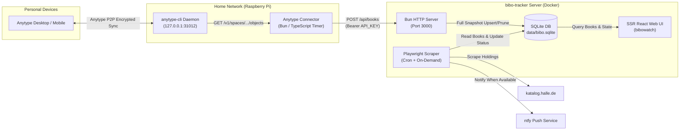

# Notion to Anytype Migration — Architecture & Refactoring Plan

This directory contains the specification and implementation plan for migrating `bibo-tracker` away from the Notion Cloud API to a self-contained SQLite data layer fed by an Anytype connector running on a home network (e.g., Raspberry Pi).

---

## 1. Context & Problem Statement

Previously, `bibo-tracker` operated as a stateless scraper and web UI backed entirely by Notion:

1. **Pull on read/scrape:** Both the web UI (`GET /`) and the scheduled Playwright scraper (`checkBooks`) queried a Notion database via `@notionhq/client` (`Ansicht = "Nächste"` and `Medium = "Bibliothek"`).
2. **Write-back to Notion:** After scraping [Bibliothek Halle (Saale)](https://katalog.halle.de/), `bibo-tracker` wrote `Verfügbar`, `Rückgabedatum`, `Standort`, and `Link` back to each Notion page.

Because **Anytype** is local-first / offline-first and exposes a **Local HTTP API** (`localhost`) rather than a public cloud REST API, the remote `bibo-tracker` server cannot pull books directly from Anytype. Furthermore, scraped library availability does **not** need to be synchronized back to Anytype — `bibo-tracker` itself serves as the single dashboard and notification engine for library availability.

---

## 2. Target Architecture

The system transitions from a **cloud pull + write-back model** to a **unidirectional push + local persistence model**:

### Key Architectural Decisions

| Area | Decision | Rationale |
| :--- | :--- | :--- |
| **Persistence** | **Bun built-in SQLite (`bun:sqlite`)** | Zero external npm dependencies, ACID transactions, safe concurrent access (WAL mode) when a sync `POST` arrives during a scrape run, and persists `lastChecked` / `lastSynced` across container restarts. |
| **Sync Strategy** | **Full Snapshot Sync (`POST /api/books`)** | Each push sends the complete active list of tracked library books. Existing books retain their scraped status (`isAvailable`, `location`, `permalink`, `returnDate`), newly added books are inserted (and immediately queued for background scraping), and omitted books are pruned. |
| **Sync Direction** | **Unidirectional (Anytype → `bibo-tracker`)** | Anytype owns book identity & metadata (`id`, `title`, `author`, list order); `bibo-tracker` owns library catalog state (`isAvailable`, `location`, `permalink`, `returnDate`). No write-back to Anytype is needed. |
| **Authentication** | **Bearer Token on `/api/*` only** | `POST /api/books` and `GET /api/books` require `Authorization: Bearer <API_KEY>`. The web UI (`GET /`), `POST /refresh`, and `GET /api/health` remain public as today. |
| **Connector Setup** | **Standalone TypeScript/Bun repo + `anytype-cli`** | Runs 24/7 on a Raspberry Pi alongside headless `anytype-cli` using a dedicated read-only Anytype bot account invited to the reading space. |

---

## 3. Documentation Index

The specification is split into three focused documents:

1. **[01 — Data Model, SQLite Schema & Sync API Specification](./01-api-and-data-model.md)**
   Defines the TypeScript domain interfaces, the `bun:sqlite` database schema, exact reconciliation rules for full snapshot sync and scraper updates, authentication rules, and the complete REST API contract (with payloads and status codes).
2. **[02 — `bibo-tracker` Data-Layer Refactoring Plan](./02-data-layer-refactoring-plan.md)**
   Step-by-step implementation guide for refactoring this repository: files to delete/create/modify, SQLite repository implementation, scraper concurrency & targeted-check enhancements, Docker volume & GitHub Actions CI/CD fixes (preventing data loss on deploy), and test strategy.
3. **[03 — Anytype Connector Implementation Guide](./03-anytype-connector-guide.md)**
   Standalone specification and reference implementation for the home-network Raspberry Pi connector: headless `anytype-cli` installation & bot setup, querying Anytype Sets/Views vs. Search filters, TypeScript/Bun reference code, safety guards, and `systemd` timer scheduling.
